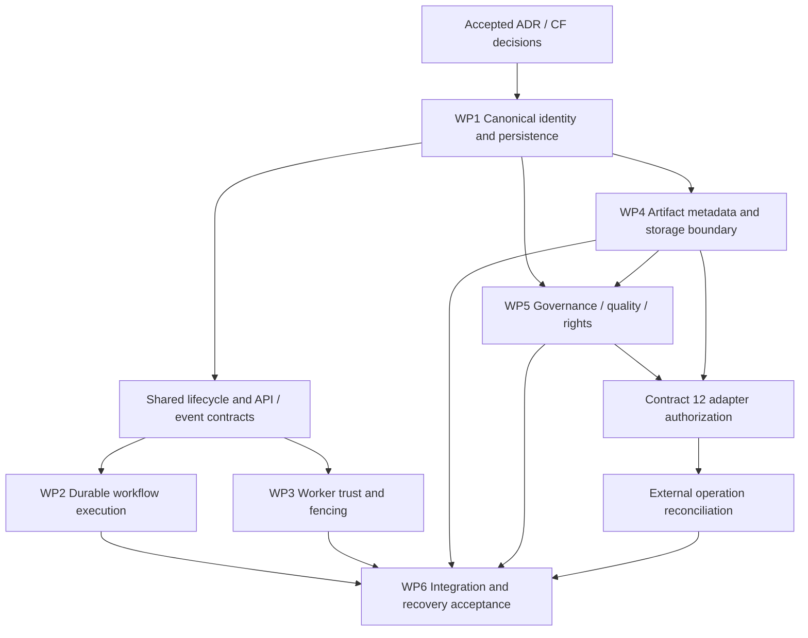

# NEXTDECODE P0 — Contract Authority & Cross-Domain Dependency Matrix

**Document ID:** NEXTDECODE_P0_Contract_Authority_and_Cross_Domain_Dependency_Matrix_0.1  
**Version:** 0.1  
**Date:** 2026-11-04  
**Status:** Working reconciliation analysis — not owner-approved, not frozen  
**Scope:** Canonical contract pack, Shared Intelligence Core Contracts 01–12, Data Dictionary v1.1, API/Event Standard, lifecycle standard, and WP1–WP6 ownership boundaries.

**Detailed contract freeze:** NOT GRANTED  
**Implementation authorization:** NOT GRANTED  
**Repository inspection/modification, tests, agent execution, provider selection, deployment, spending and external side effects:** NOT AUTHORIZED

---

## 1. Purpose

This matrix establishes a source-grounded view of:
- Which source governs accepted architecture and contract decisions.
- Which domain owns each canonical entity and authoritative state.
- Which contracts consume or depend on other contracts.
- Which interfaces and lifecycle/event rules apply across domains.
- Which conflicts require owner or domain-owner disposition before a detailed contract freeze.

It is a reconciliation aid. It does not replace accepted ADR/CF decisions, amend source contracts, or grant implementation authority.

## 2. Source authority and status

### 2.1 Authority hierarchy

Use this precedence when sources conflict:

1. **Accepted owner decisions:** ADR-001–ADR-010 and CF-01–CF-24 in the consolidated owner decision record and accepted-decision implementation reference.
2. **Accepted P0 architecture baseline and ADR records:** including the PostgreSQL-compatible authoritative shared-state decision, UUIDv7 identity, durable DB-backed queue/outbox/inbox direction, centralized authorization, and lifecycle separation.
3. **Governing standards:** API/Event Contract Standard 1.0, Unified Lifecycle & State Transition Standard 1.0, and Canonical Data Dictionary v1.1 for the latest working propagation of accepted CF-20/CF-21 vocabulary. Data Dictionary v1.1 remains a working architecture standard, not a frozen schema.
4. **Domain contracts:** Shared Intelligence Core Contracts 01–12, each within its domain ownership. Their current status is working architecture contract/documentation only unless explicit owner evidence says otherwise.
5. **WP1–WP6 boundary and reconciliation packages:** candidates within the accepted domain boundaries; they cannot override accepted ADR/CF decisions.
6. **P0 Consolidated Contract Appendix, batch packages and reconciliation documents:** derivative planning/review aids. They do not independently create authority.

Where a source contains older vocabulary, preserve its text as historical source evidence and record the conflict. Do not silently translate, coerce or backfill data.

### 2.2 Status vocabulary

| Status | Meaning |
|---|---|
| ACCEPTED DECISION | Explicitly recorded accepted owner ADR/CF decision |
| SOURCE-DEFINED | Requirement stated in a governing source, but not necessarily separately owner-ratified as a detailed schema |
| WORKING CONTRACT | Domain contract exists; documentation-only and not frozen |
| RECONCILIATION CANDIDATE | Cross-source interpretation proposed for review |
| OPEN | Exact semantics, ownership, schema or owner disposition is unresolved |
| NOT VERIFIED | No implementation/runtime/test evidence is claimed |
| NOT AUTHORIZED | Work or side effect requires separate explicit authorization |

A document's version number or recent timestamp does not by itself promote it to accepted or frozen status.

## 3. Cross-domain canonical ownership matrix

| Domain / contract | Canonical ownership supported by sources | Key dependencies / consumers | Reconciliation notes |
|---|---|---|---|
| Contract 01 — Audience Identity & Context | Audience, Persona, AudienceSegment, AudienceInsight | Contracts 06, 08, 11, 12 | Contract 08 consumes audience identity; it does not create a competing audience owner. |
| Contract 02 — Opportunity & Evidence | Opportunity, EvidenceSource, EvidenceItem, Claim, ClaimEvidenceLink | Contracts 05, 06, 07, 11, 12 | Research execution belongs to Contract 05; canonical evidence/claim identity belongs here. |
| Contract 03 — Brand & Editorial Intelligence | WorkspaceBrand and immutable StudioIdentity definitions/versions | Contracts 06, 07, 11, 12 | Contract 11 must reference exact StudioIdentity versions; it must not create a second owner. |
| Contract 04 — Shared Knowledge & Learning | Knowledge records and shared epistemic-status model | Contracts 05, 06, 08, 11, 12 | Keep epistemic status distinct from lifecycle, provenance, quality, rights and approval. |
| Contract 05 — Research Intelligence & Evidence Operations | Research requests/runs, source collection and synthesis operations | Contracts 02, 04, 06, 07, 11 | Produces evidence/claim candidates and research lineage; Contract 02 owns canonical evidence identities. |
| Contract 06 — Strategy & Portfolio Intelligence | Strategy, planning, portfolio and decision-support records | Contracts 01, 02, 03, 08, 09, 11, 12 | Consumes domain-owned inputs; does not duplicate audience, evidence, brand or financial truth. |
| Contract 07 — Content Quality, Rights & Governance | QualityAssessment, Rights/Provenance assessment, GovernanceDecision, Approval, PublishingAuthorization and governance policy outcomes | Contracts 02, 03, 05, 10, 11, 12 and Part 7 | Central gate. Every publishing adapter must enforce its authorization. Contract 07 v1.0 has stale CF-20/CF-21 vocabulary requiring controlled reconciliation. |
| Contract 08 — Audience Performance Intelligence | MetricDefinition, PerformanceSnapshot, AttributionRecord, Experiment, ExperimentResult | Contracts 01, 06, 09, 11, 12 | Consumes audience identity and distribution outcomes; Contract 09 remains owner of financial records. |
| Contract 09 — Business & Monetization Intelligence | BusinessOpportunity, CommercialProspect, CommercialProposal, FinancialRecord, BusinessPerformanceSnapshot | Contracts 06, 08, 12 | Financial truth is not inferred solely from platform analytics. Binding commercial commitments remain outside agent authority. |
| Contract 10 — Agent & Resource Orchestration | AgentIdentity/Version, AgentCapability, ProviderRecord, ModelRecord, Task, WorkflowDefinition/Run, Job/Attempt, WorkerIdentity, ResourceAccount, UsageRecord | All domain contracts; WP2/WP3/WP6 | Owns execution orchestration and worker/resource identities, not business-domain entities. Must not grant its own permissions. |
| Contract 11 — Multiformat Creation & Studio Intelligence | CreationProject, FormatProfile, CreativeDirectionBrief, CreativeConcept, StudioProduction, DerivativeRelationship | Contracts 01–10, 12; Parts 3/4/7; WP1/WP2/WP4/WP5 | Confirmed CF-20 legacy rights-token conflict; field completeness differs from Data Dictionary v1.1. Contract 03 owns StudioIdentity. |
| Contract 12 — Distribution, Channel & Publishing | ChannelProfile, ChannelAccount, DistributionStrategy, ChannelSuitabilityAssessment, DistributionPackage/Version, ScheduleProposal, PublishOperation, Publication | Contracts 03, 07, 08, 09, 10, 11; Part 7; WP5/WP6 | Owns external operation and publication records. Contract 07 owns authorization. Upload, publication and public visibility are distinct facts. |
| Part 7 — Asset/Artifact integration | Artifact, immutable ArtifactVersion, Asset, binary-storage abstraction and lineage references | Contracts 02, 07, 11, 12; WP4 | Asset ≠ Artifact ≠ ArtifactVersion. Metadata and binary storage boundaries must not be conflated. |

## 4. Foundational cross-domain invariants

These are source-supported architecture constraints and must be preserved across all contract revisions:

1. Canonical IDs are opaque, immutable UUIDv7 values. Display names/slugs are not identity.
2. Each canonical entity and authoritative state machine has one owning domain.
3. Consumers request changes through the owning domain's command/API; they do not write directly into another domain's authoritative tables.
4. ContentItem is the shared editorial identity; ContentVariant is a format/platform/language/treatment derivative.
5. Content identity and content/artifact version identity are distinct.
6. Asset ≠ Artifact ≠ ArtifactVersion. ArtifactVersion is immutable; material changes create a new version.
7. Approval and quality/rights evidence bind to exact immutable content/artifact/manifest versions and checksums where required.
8. Research completion does not itself establish claim verification; Contract 07 assesses claims used in the actual final artifact.
9. Each derivative receives independent production, QA, rights and approval records. Shared research does not imply shared approval.
10. Contract 03 owns StudioIdentity. Contract 11 consumes exact immutable versions.
11. Contract 07 owns quality, rights, governance, approval and publishing authorization.
12. Contract 12 owns distribution package and external operation records; it cannot authorize itself.
13. Contract 10 owns orchestration/worker execution. WorkflowRun, Task, Job and JobAttempt are distinct records and are not interchangeable.
14. A command is intent; an event is a committed fact; neither is automatically permission.
15. At-least-once event delivery is assumed; consumers are idempotent. No global exactly-once guarantee.
16. Unknown external outcomes require reconciliation before unsafe retry.
17. Human silence or owner unavailability never implies approval.
18. Automatic public publishing remains disabled pending separate explicit owner-approved policy.

## 5. Cross-contract lifecycle and state ownership

| Concern | Authoritative owner | Consumers | Required distinction |
|---|---|---|---|
| Domain entity lifecycle | Entity-owning contract | Other domains through references/events | Domain lifecycle is not workflow execution state. |
| Workflow definition/run | Contract 10 / WP2 | Contracts 05–12 | Definition ≠ run. Run ≠ task/job. |
| Task and job execution | Contract 10 / WP2 | Domain services, WP3, WP6 | Job ≠ JobAttempt; lease/attempt state is not business entity state. |
| Worker identity/trust/credentials | Contract 10 / WP3 | WP2, WP6, service boundaries | Worker health is not permission; revocation/fencing must be enforced. |
| Artifact/asset lifecycle | Part 7 / WP4 | Contracts 07, 11, 12 | Artifact metadata/version lifecycle differs from binary object lifecycle. |
| Quality assessment | Contract 07 / WP5 | Contracts 11, 12 | PASS, PASS_WITH_WARNINGS, NEEDS_REVIEW, BLOCKED are quality outcomes, not approval decisions. |
| Rights assessment | Contract 07 / WP5 | Contracts 11, 12 | Rights are use-specific; unknown/pending/expired/revoked/denied are not clearance. |
| Approval | Contract 07 / WP5 | Contracts 11, 12 | Approval decision ≠ authorization ≠ execution ≠ publication success. |
| Publishing authorization | Contract 07 / WP5 | Contract 12 adapters | Short-lived, exact artifact/version/destination/action/policy scope. |
| Distribution package/schedule | Contract 12 | Contract 07, 10, 08 | Prepared/validated/proposed is not authorized or published. |
| External operation/publication | Contract 12 / WP6 | Contract 08, owner review | Submitted, uploaded, published and publicly visible are distinct confirmed states. |
| Emergency/pause state | Central governance / Contract 07; adapter enforcement in Contract 12 | WP2/WP3/WP5/WP6 | Must stop new protected actions; in-flight external request semantics remain adapter-specific/open. |

## 6. API, command and event cross-domain requirements

The API/Event Standard 1.0 is the governing communication standard. The existing API/Event Reconciliation 0.1 is a design candidate and explicitly does not replace it.

### 6.1 Command boundary

- Query APIs are read-only.
- Commands request a state change from the owning domain.
- The owner validates identity, scope, capability, policy, state legality, expected version and required approval.
- Server derives authenticated identity; caller-supplied `requested_by` is not proof.
- Retryable commands require idempotency; state-changing commands require expected-version protection.
- ACCEPTED means durably accepted, not completed.

### 6.2 Event boundary

- Events announce committed facts, not intentions or permissions.
- Event owner is the domain that commits the fact.
- Event envelope aligns with the lifecycle envelope.
- At-least-once delivery, idempotent consumers, per-aggregate ordering and reconciliation on version gaps.
- Transactional outbox/inbox direction is accepted baseline; no distributed exactly-once promise.
- Replay must not trigger external side effects by default.

### 6.3 Important open API/Event details

The reconciliation candidate identifies these as still open or proposed rather than frozen:
- Exact correlation/causation nullability and typed reference representation.
- Event ordering when multiple events share one aggregate state version.
- Exact outbox/inbox table/index/retention/claim protocol.
- Idempotency key retention and canonicalization.
- Error-code catalogue and numeric retry/backoff values.
- Schema registry format, compatibility window and dual-publish period.
- Poison-message redrive permissions and replay controls.
- Exact webhook signature/nonce/clock-skew/replay policy details.
- Field-level schemas for domain commands and events.

## 7. Confirmed reconciliation conflicts

### CFX-01 — Contract 07 rights vocabulary is stale against CF-20

**Evidence**
- Contract 07 v1.0 lists `CLEARED`, `RESTRICTED`, `PENDING_VERIFICATION`, `PROHIBITED`, `UNKNOWN`.
- Accepted CF-20 and Data Dictionary v1.1 list `UNKNOWN`, `PENDING_REVIEW`, `CLEARED`, `RESTRICTED`, `EXPIRED`, `REVOKED`, `DENIED`.
- Data Dictionary v1.1 includes documentation-only compatibility notes and explicitly prohibits assuming perfect semantic equivalence or automatic migration/coercion.

**Disposition**
- Treat the accepted CF-20 vocabulary as governing.
- Contract 07 needs a controlled owner-reviewed revision.
- Preserve old tokens as historical source vocabulary until an explicit migration/compatibility decision exists.
- Do not silently alias, coerce, migrate or backfill.

**Owner action:** Contract 07 domain owner + owner decision on exact wording/compatibility.

### CFX-02 — Contract 07 approval vocabulary differs from CF-21

**Evidence**
- Contract 07 v1.0 approval outcomes include `APPROVED`, `REJECTED`, `CHANGES_REQUESTED`, `EXPIRED`, `WITHDRAWN`.
- Data Dictionary v1.1's accepted CF-21 vocabulary is `APPROVED`, `REJECTED`, `CHANGES_REQUESTED`, `EXPIRED`, `REVOKED`.
- Contract 07 also defines withdrawal as an approval-request lifecycle event/state concept.

**Disposition**
- Do not conflate ApprovalDecision with ApprovalRequest lifecycle.
- Confirm whether `WITHDRAWN` belongs only to the request lifecycle and whether `REVOKED` is the canonical decision/approval invalidation outcome.
- Exact state-machine and event mapping needs owner review.

**Owner action:** Contract 07 domain owner + WP5; owner confirmation required for canonical vocabulary.

### CFX-03 — Contract 11 field ownership/completeness differs from Data Dictionary v1.1

**Evidence**
- Contract 11 v1.0 describes broader CreationProject and StudioProduction details.
- Data Dictionary v1.1 lists smaller canonical field sets.
- Contract 03 is the canonical owner of StudioIdentity; Contract 11 must reference immutable versions.
- Part 7 owns shared artifact/asset integration; Contract 07 owns governance/rights/approval; Contract 10 owns workflow/job/worker execution.

**Disposition**
- Do not assume omitted fields were removed.
- Map each Contract 11 field to: canonical entity attribute, typed reference to another owner, versioned specification/payload, or operational field owned by WP2/WP3/WP4.
- Do not duplicate canonical fields or state.

**Owner action:** Contract 11 domain owner + WP1/WP2/WP4/WP5 boundary review.

### CFX-04 — API/Event reconciliation precedence references Data Dictionary 1.0

**Evidence**
- API/Event Reconciliation 0.1 lists Data Dictionary 1.0 in its source precedence.
- Data Dictionary v1.1 was later located in Library and carries CF-20/CF-21 propagation notes.
- The reconciliation 0.1 itself says it is a conformance aid and cannot replace governing sources.

**Disposition**
- Accepted CF-20/CF-21 decisions remain highest authority.
- Use v1.1 as the latest working propagation of those accepted decisions.
- Preserve v1.0 and record the version-precedence issue; do not claim formal v1.1 supersession without owner evidence.
- Update the reconciliation document only through a controlled revision after owner review.

**Owner action:** Architecture/data owner; confirm v1.1 status and revise source list in a controlled version.

### CFX-05 — Contract 12 authorization boundary must remain external to distribution ownership

**Evidence**
- Contract 12 owns channel profiles/accounts, distribution packages, schedule proposals, publish operations and publication records.
- Contract 07 owns governance decisions and publishing authorization.
- Contract 12 requires every external operation to pass centralized authorization and keeps autonomous public publishing disabled.
- API/Event Standard prohibits events/commands from being treated as permission.

**Disposition**
- Contract 12 may request authorization and execute only after a current valid decision is checked at the adapter boundary.
- It cannot mint or infer its own authorization.
- A timeout/unknown outcome enters reconciliation before retry.
- Human silence never grants approval.

**Owner action:** Contract 07 + Contract 12 + WP5/WP6 conformance review.

### CFX-06 — Lifecycle envelope and event envelope must not fork

**Evidence**
- API/Event Standard requires the common event envelope from Unified Lifecycle & State Transition Standard 1.0.
- API/Event Reconciliation 0.1 explicitly treats field mapping and lifecycle alignment as the governing requirement.
- WP2/WP4/WP6 use different state machines but share correlation, actor, state version and event semantics.

**Disposition**
- Maintain one shared envelope meaning, with state-machine-specific payloads.
- Keep content, workflow, execution, review, approval, authorization and distribution states separate.
- Exact field nullability and multi-event-per-version semantics remain open.

**Owner action:** Architecture + WP2/WP4/WP5/WP6.

## 8. WP1–WP6 dependency and boundary matrix

| Work package | Owns / primary responsibility | Depends on | Must not absorb |
|---|---|---|---|
| WP1 — Canonical Domain & Persistence Foundation | Canonical entities, identity/version, typed relationships, ownership and minimum persistence boundary | Accepted ADRs, Data Dictionary, Contracts 01–12, migration compatibility | Full workflow engine, worker trust, artifact binary storage, governance decision engine |
| WP2 — Workflow Execution | Workflow definitions/runs, durable orchestration, task/job lifecycle, queue/outbox/inbox integration, retries/checkpoints/recovery | WP1 identities/relationships, API/Event, Contract 10, lifecycle standard | Worker credential authority, business entity lifecycle, rights/approval decisions |
| WP3 — Worker Trust | Worker registration/identity, capability, scoped credentials, trust/health, revocation and fencing | WP1 identity/scope, WP2 job/lease lifecycle, Contract 10, security decisions | Workflow definition ownership, business authorization, provider/budget approval |
| WP4 — Artifact Storage | Artifact/ArtifactVersion metadata, binary storage abstraction, transfer/integrity, lineage and lifecycle mechanics | WP1 IDs/relations, Data Dictionary, Part 7, Contracts 07/11/12 | Rights decision ownership, approval decisions, studio production lifecycle |
| WP5 — Governance, Quality & Rights | Quality/rights assessments, governance decisions, approval and publishing authorization, policy enforcement | WP1 canonical references, Contracts 02/03/07/11/12, WP4 exact artifacts, WP6 enforcement/recovery | Artifact binary storage, distribution operation ownership, workflow/worker execution |
| WP6 — Integration, Recovery & Acceptance | Cross-boundary integration, failure/recovery/reconciliation validation, contract test oracle and release acceptance evidence | WP1–WP5 contracts, API/Event, lifecycle standard, repository baseline when separately authorized | Replacing domain owners, changing accepted contracts, granting implementation authorization |

WP ownership above is the logical scope recorded in the P0 workstream packages and accepted boundaries. It is not a new assignment or implementation work order.

## 9. Priority dependency graph

This graph represents logical dependencies only. It is not a delivery schedule or approval to begin implementation.

## 10. Contract-by-contract closure register

| Contract | Current disposition | Next closure action |
|---|---|---|
| 01 | Working contract; ownership boundary appears consistent with Data Dictionary | Complete section-level review and verify all consumers use canonical audience refs |
| 02 | Working contract; canonical evidence/claim ownership | Verify Claim/Evidence identity, provenance and relationship semantics against Contracts 05/07/11 |
| 03 | Working contract; canonical Brand/StudioIdentity owner | Verify immutable identity/version semantics and exact consumer references |
| 04 | Working contract; Knowledge/epistemic status owner | Reconcile epistemic vocabulary with provenance, lifecycle, quality and rights registries |
| 05 | Working contract; research execution owner | Verify research run/task/job separation and canonical evidence handoff to Contract 02 |
| 06 | Working contract; strategy/portfolio owner | Verify cross-domain reference-only behavior and no duplicated audience/brand/evidence/financial truth |
| 07 | Working contract; central governance owner | **Priority:** reconcile CF-20 rights tokens and CF-21 approval/request states; exact authorization schema and pause/in-flight behavior remain open |
| 08 | Working contract; performance/experiment owner | Verify metric provenance/window and separation from Contract 09 financial truth |
| 09 | Working contract; financial/commercial owner | Verify financial-record authority and prohibited commitment boundaries |
| 10 | Working contract; orchestration/agent/resource owner | Resolve X-01 WorkflowDefinition/Run/Task/Job/Attempt ownership and WP2/WP3 split |
| 11 | Working contract; creation/studio production owner | **Priority:** close C11-01..C11-07; CF-20 conflict and field ownership map remain open |
| 12 | Working contract; distribution/external operation owner | Verify all adapter paths require Contract 07 authorization; distinguish package, schedule, upload, publication and visibility |

## 11. Required owner decisions / unresolved matters

The following are not to be decided by an agent or by this matrix:

1. Contract 07's exact revised rights vocabulary and treatment of legacy values.
2. Approval decision vocabulary versus ApprovalRequest lifecycle states.
3. Contract 11 canonical CreationProject and StudioProduction field mapping.
4. Whether Data Dictionary v1.1 formally supersedes or supplements v1.0.
5. Exact correlation/causation representation and event ordering for multiple events at one aggregate version.
6. Protected-action catalogue, emergency pause and in-flight external action behavior.
7. Retention, legal hold, deletion/purge and backup propagation.
8. Worker trust/revocation and active-task fencing details where owner-reserved.
9. Contract-by-contract freeze approval and evidence.
10. Any implementation authorization, repository access, tests, external integrations, deployment, spending or publishing.

## 12. Recommended next sequence

1. **Contract 07 / WP5 closure:** rights vocabulary, approval/request state separation, exact artifact/manifest/version/checksum binding, authorization enforcement, emergency pause and in-flight adapter treatment.
2. **Contract 11 / WP1-WP2-WP4 closure:** canonical field ownership for CreationProject and StudioProduction, StudioIdentity reference, workflow/job references, ArtifactVersion and rights/QA references.
3. **Contract 12 / WP5-WP6 closure:** adapter authorization, package/operation/publication states, unknown outcome and reconciliation.
4. **Contract 10 / WP2-WP3 closure:** X-01 identity and worker execution boundaries.
5. **API/Event + Lifecycle closure:** resolve shared envelope/open semantics without forking domain state machines.
6. Complete Contracts 01–06 and 08–09 section-level cross-source review.
7. Produce a contract-by-contract owner review pack with exact clauses and decision options; do not mark anything frozen until owner evidence is explicit.

---

## 13. Explicit non-authorization

This matrix does not:
- approve or freeze any detailed contract;
- amend a canonical source document;
- authorize repository or code inspection/change;
- authorize Git operations, tests or agent execution;
- authorize provider/account connection, deployment or spending;
- authorize uploads, external distribution or public publishing.

**Current result:** ownership and major dependency boundaries are mapped; six concrete cross-source conflict classes are recorded; detailed freeze and implementation authorization remain NOT GRANTED.

**End of matrix.**
